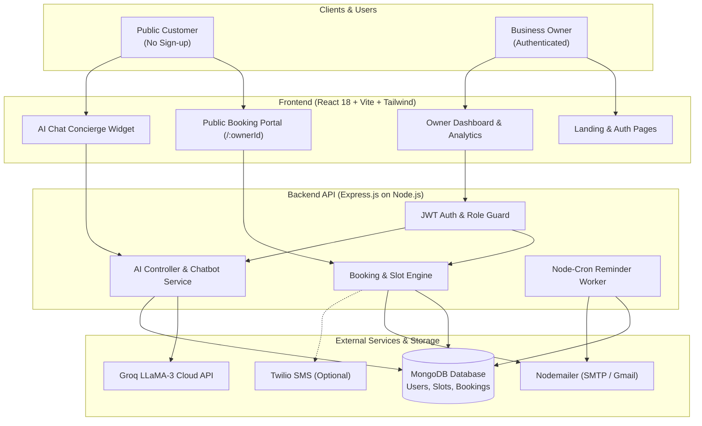

# ✂️ ZenBooking

<div align="center">


### **AI-Powered Appointment Booking & Scheduling Platform for Salons & Service Businesses**

[](https://react.dev/)
[](https://vitejs.dev/)
[](https://nodejs.org/)
[](https://expressjs.com/)
[](https://www.mongodb.com/)
[](https://groq.com/)
[](https://tailwindcss.com/)
[](LICENSE)

---

### 🌐 [Live Client Application](https://v-booking-nine.vercel.app/) &nbsp;•&nbsp; ⚡ [Live API Service](https://vbooking.onrender.com/)

</div>

---

## 📖 Table of Contents

- [Overview](#-overview)
- [✨ Key Features](#-key-features)
- [🏗️ System Architecture](#️-system-architecture)
- [📸 Application Showcase](#-application-showcase)
- [🛠️ Tech Stack](#️-tech-stack)
- [📁 Project Structure](#-project-structure)
- [🔌 API Reference](#-api-reference)
- [⚙️ Getting Started & Installation](#️-getting-started--installation)
  - [Prerequisites](#prerequisites)
  - [Backend Setup](#backend-setup)
  - [Frontend Setup](#frontend-setup)
- [🧪 Testing & Scripts](#-testing--scripts)
- [🚀 Deployment Guide](#-deployment-guide)
- [🔐 Security & Design Highlights](#-security--design-highlights)
- [🗺️ Product Roadmap](#️-product-roadmap)
- [🤝 Contributing](#-contributing)
- [📄 License](#-license)
- [👤 Author & Connect](#-author--connect)

---

## 🌟 Overview

**ZenBooking** is a full-stack, enterprise-ready appointment management platform engineered specifically for salons, barber shops, studios, and independent service professionals. By fusing **Groq-accelerated AI natural language processing** with a real-time scheduling engine, ZenBooking eliminates double-booking, manual coordination headaches, and phone tag.

### How It Works:
1. **Business Owners** create an account, configure weekly operating hours, slot intervals, and holidays, and receive a dedicated public booking link (e.g., `/:ownerId`).
2. **Customers** visit the public link—**with zero login or account creation required**—and choose an available slot in seconds or chat with the built-in AI concierge.
3. **The AI Assistant** understands natural language requests (e.g., *"Can I book a haircut this Thursday at 3 PM?"*), checks live availability, and reserves the appointment seamlessly.
4. **Automated Reminders & Email Notifications** keep both clients and business owners synchronized, cutting no-shows and driving customer satisfaction.

---

## ✨ Key Features

### 🤖 Conversational AI Booking Concierge
- **Natural Language Parsing**: Understands flexible customer queries, extracted dates, times, and service intents powered by Groq LLaMA models.
- **Availability-Aware**: Validates requested times against existing reservations and owner-configured working intervals in real time.
- **Instant Booking Confirmation**: Creates bookings and delivers confirmations straight from the chat interface.

### 📅 Smart Slot & Schedule Management
- **Custom Working Hours**: Set recurring day-of-week shifts with customizable time ranges and slot durations (e.g., 15m, 30m, 45m, 60m).
- **Holiday & Blackout Dates**: Mark personal time off, public holidays, or maintenance days to prevent accidental bookings.
- **Atomic Concurrency Control**: Prevents double-bookings across concurrent requests.

### 📊 Real-Time Business Dashboard & Insights
- **Live Booking Feed**: Filter, search, reschedule, or cancel bookings on the fly.
- **Visual Analytics**: Interactive peak-hour charts and weekly booking distribution curves.
- **AI-Generated Business Insights**: Contextual operational tips and volume analysis based on recent reservation data.

### ⚡ Frictionless Client Experience
- **No Sign-Up Barrier**: Clients pick a slot and provide only their name and contact info (phone/email).
- **Shareable Booking Links**: Instant sharing across Instagram bios, WhatsApp messages, Google Business profiles, or websites.
- **Automated Email Notifications**: Beautiful HTML confirmation receipts with calendar links and automated cron reminders.

### 🎨 "Warm Atelier" UI & Accessibility
- **Modern Theme System**: One-click toggle between polished Light and Dark themes across all landing, auth, and dashboard pages.
- **Framer Motion Micro-Interactions**: Smooth transitions, accessible modals, responsive sidebars, and skeleton states.
- **Mobile First**: Optimized touch targets and responsive layouts tailored for mobile clients and tablets.

---

## 🏗️ System Architecture



---

## 📸 Application Showcase

### 🏠 Landing Page
A clean, conversion-focused landing page introducing the platform, key value propositions, live demo access, and responsive dark/light mode.

<p align="center">
  
</p>

---

### 📊 Owner Dashboard & Business Analytics
Comprehensive metrics including total bookings, upcoming appointments, occupancy rate, peak booking hours, and Groq-powered AI insights.

<p align="center">
  
</p>

---

### 📋 Booking Management
Effortlessly review incoming client reservations, update statuses, reschedule appointments, or issue instant cancellations.

<p align="center">
  
</p>

---

### 📅 Public Client Booking Flow
Frictionless public portal where clients select dates, choose from open intervals, and confirm reservations in two quick steps.

<p align="center">
  
</p>

---

### 💬 AI Chat Concierge (Desktop & Mobile)
Interactive AI assistant that parses natural speech, answers schedule questions, and books appointments on demand.

<p align="center">
  
  &nbsp; &nbsp; &nbsp;
  
</p>

---

## 🛠️ Tech Stack

### Client / Frontend
- **Core**: [React 18](https://react.dev/), [Vite](https://vitejs.dev/)
- **Routing**: [React Router DOM v6](https://reactrouter.com/)
- **Styling**: [Tailwind CSS](https://tailwindcss.com/), PostCSS, Autoprefixer
- **State Management**: [Zustand](https://github.com/pmndrs/zustand)
- **Networking**: [Axios](https://axios-http.com/) (with interceptors & token refresh)
- **Animations & Icons**: [Framer Motion](https://www.framer.com/motion/), [Lucide React](https://lucide.dev/)
- **Hosting**: [Vercel](https://vercel.com/)

### Server / Backend
- **Runtime & Framework**: [Node.js](https://nodejs.org/), [Express.js](https://expressjs.com/)
- **Database**: [MongoDB](https://www.mongodb.com/) with [Mongoose ODM](https://mongoosejs.com/)
- **Authentication**: JWT (JSON Web Tokens) with dual Access & HTTP-only Refresh Token strategy, [bcryptjs](https://github.com/dcodeIO/bcrypt.js)
- **Artificial Intelligence**: [Groq Cloud SDK](https://groq.com/) (LLaMA-3 models)
- **Notifications**: [Nodemailer](https://nodemailer.com/) (SMTP/Gmail), optional [Twilio SMS](https://www.twilio.com/)
- **Background Jobs**: [node-cron](https://github.com/node-cron/node-cron)
- **Validation**: [express-validator](https://express-validator.github.io/)
- **Hosting**: [Render](https://render.com/)

---

## 📁 Project Structure

```text
SalonBook/
├── backend/
│   ├── ai/                      # AI integration & Groq LLM orchestration
│   │   ├── chatbot.js           # Conversational booking logic
│   │   ├── groqClient.js        # Groq client initialization
│   │   ├── insights.js          # Business analytics extraction prompts
│   │   ├── prompts.js           # System prompts & few-shot instructions
│   │   └── reminder.js          # Dynamic reminder copy generator
│   ├── config/                  # Database & environment configurations
│   ├── controllers/             # Express route controllers
│   │   ├── ai.controller.js     # AI endpoints (owner & public chat)
│   │   ├── auth.controller.js   # Registration, login, profile, refresh
│   │   ├── booking.controller.js# Booking CRUD operations
│   │   ├── public.controller.js # Public storefront & booking handler
│   │   └── slot.controller.js   # Slot configuration & holidays
│   ├── jobs/                    # Scheduled tasks (reminderCron.js)
│   ├── middleware/              # JWT auth and request validation middlewares
│   ├── models/                  # Mongoose models (User, SlotConfig, Booking)
│   ├── routes/                  # Modular Express API routers
│   ├── scripts/                 # Smoke & integration testing scripts
│   ├── services/                # Notification, booking, and slot services
│   ├── server.js                # Express app entry point
│   └── package.json
│
├── frontend/
│   ├── src/
│   │   ├── api/                 # Axios API service modules
│   │   ├── components/          # Reusable UI component library
│   │   │   ├── booking/         # Calendar, slot pickers, cards, badges
│   │   │   ├── charts/          # Peak hours & booking trends charts
│   │   │   ├── chat/            # Floating AI chat widget & bubble UI
│   │   │   ├── layout/          # Dashboard & public layouts, topbar, sidebar
│   │   │   └── ui/              # Buttons, inputs, modals, avatars, skeletons
│   │   ├── hooks/               # Custom hooks (useTheme, useAuth, etc.)
│   │   ├── pages/               # Application view routes
│   │   │   ├── auth/            # Login & Register views
│   │   │   ├── dashboard/       # DashboardHome, Bookings, Slots, Insights
│   │   │   └── public/          # Public booking & landing pages
│   │   ├── store/               # Zustand global store slices
│   │   ├── App.jsx              # Application routing & layout tree
│   │   └── main.jsx             # React entry point
│   ├── tailwind.config.js       # Tailwind CSS theme configuration
│   ├── vite.config.js           # Vite build pipeline configuration
│   └── package.json
│
└── README.md                    # Project documentation
```

---

## 🔌 API Reference

### Authentication (`/api/auth`)
| Method | Endpoint | Auth | Description |
| :--- | :--- | :---: | :--- |
| `POST` | `/api/auth/register` | None | Register a new business owner |
| `POST` | `/api/auth/login` | None | Authenticate owner and receive tokens |
| `POST` | `/api/auth/refresh` | Cookie | Exchange refresh token for new access token |
| `GET` | `/api/auth/me` | Bearer | Retrieve authenticated profile details |
| `PATCH` | `/api/auth/me` | Bearer | Update owner profile or business preferences |

### Slots & Schedules (`/api/slots`)
| Method | Endpoint | Auth | Description |
| :--- | :--- | :---: | :--- |
| `GET` | `/api/slots` | Bearer | Get owner's configured recurring weekly slots |
| `POST` | `/api/slots` | Bearer | Create or update slot configurations for day of week |
| `GET` | `/api/slots/holidays` | Bearer | Retrieve configured holiday/blackout dates |
| `POST` | `/api/slots/holidays` | Bearer | Add a new holiday/blackout date |
| `DELETE` | `/api/slots/holidays/:id`| Bearer | Remove a holiday/blackout date |

### Bookings (`/api/bookings`)
| Method | Endpoint | Auth | Description |
| :--- | :--- | :---: | :--- |
| `GET` | `/api/bookings` | Bearer | List all bookings with optional query filters |
| `POST` | `/api/bookings` | Bearer | Manually record a booking from the owner panel |
| `PUT` | `/api/bookings/:id` | Bearer | Reschedule an existing appointment |
| `DELETE` | `/api/bookings/:id` | Bearer | Cancel an appointment and notify client |

### Public Customer Flow (`/api/public`)
| Method | Endpoint | Auth | Description |
| :--- | :--- | :---: | :--- |
| `GET` | `/api/public/:ownerId` | None | Fetch public salon profile, available slots & hours |
| `POST` | `/api/public/book` | None | Public customer booking submission |

### AI Concierge (`/api/ai`)
| Method | Endpoint | Auth | Description |
| :--- | :--- | :---: | :--- |
| `POST` | `/api/ai/public/:ownerId/chat` | None | Customer AI conversation for questions & bookings |
| `POST` | `/api/ai/chat` | Bearer | Owner-side AI assistant |
| `GET` | `/api/ai/insights` | Bearer | Generates AI analytics and business health review |
| `POST` | `/api/ai/reminder/:bookingId` | Bearer | AI-personalized reminder copy regeneration |

---

## ⚙️ Getting Started & Installation

### Prerequisites
- [Node.js](https://nodejs.org/) (version `18.x` or higher recommended)
- [npm](https://www.npmjs.com/) or [yarn](https://yarnpkg.com/)
- A running [MongoDB](https://www.mongodb.com/) cluster (Atlas or local instance)
- A [Groq API Key](https://console.groq.com/) for AI-assisted features
- An SMTP email account (e.g., Gmail App Password) for booking notifications

---

### Backend Setup

1. **Navigate to the backend directory**:
   ```bash
   cd backend
   ```

2. **Install dependencies**:
   ```bash
   npm install
   ```

3. **Configure environment variables**:
   Create a `.env` file in `backend/` based on `.env.example`:
   ```bash
   cp .env.example .env
   ```

   Fill in your configuration:
   ```env
   # Application Port
   PORT=8000

   # MongoDB Connection
   MONGO_URI=mongodb+srv://<username>:<password>@cluster.mongodb.net/zenbooking?retryWrites=true&w=majority

   # JWT Secrets (generate strong random secrets)
   JWT_SECRET=super_secret_access_jwt_key_here
   JWT_REFRESH_SECRET=super_secret_refresh_jwt_key_here

   # Email Service (Nodemailer / SMTP)
   EMAIL_HOST=smtp.gmail.com
   EMAIL_PORT=587
   EMAIL_USER=your_email@gmail.com
   EMAIL_PASS=your_app_specific_password

   # AI Acceleration
   GROQ_API_KEY=gsk_your_groq_api_key_here

   # Allowed CORS Origins (comma-separated)
   FRONTEND_URLS=http://localhost:5173,https://v-booking-nine.vercel.app

   # Optional SMS via Twilio
   TWILIO_SID=your_twilio_sid
   TWILIO_TOKEN=your_twilio_token
   TWILIO_FROM=+1234567890

   # Development / Testing Flags
   NOTIFY_TEST_MODE=0
   EMAIL_RETRY_ATTEMPTS=3
   ```

4. **Start the backend development server**:
   ```bash
   npm run dev
   ```
   The backend API will start on `http://localhost:8000`.

---

### Frontend Setup

1. **Navigate to the frontend directory**:
   ```bash
   cd ../frontend
   ```

2. **Install dependencies**:
   ```bash
   npm install
   ```

3. **Configure environment variables**:
   Create a `.env` file in `frontend/`:
   ```bash
   cp .env.example .env
   ```

   Set the API URL for local development:
   ```env
   VITE_API_URL=http://localhost:8000/api
   ```

4. **Start the Vite dev server**:
   ```bash
   npm run dev
   ```
   Open `http://localhost:5173` in your browser.

---

## 🧪 Testing & Scripts

The backend includes purpose-built automated verification scripts:

```bash
cd backend

# Run the notification delivery smoke test
node scripts/smokeNotifyTest.js

# Run the end-to-end AI booking integration test
node scripts/integrationTest.js
```

Frontend scripts:
```bash
cd frontend

# Run local development server with HMR
npm run dev

# Build production assets for deployment
npm run build

# Preview the production build locally
npm run preview
```

---

## 🚀 Deployment Guide

### Deploying the Backend on Render
1. Push your repository to GitHub.
2. Sign in to [Render Dashboard](https://dashboard.render.com/) and create a new **Web Service**.
3. Select your repository, pick the `backend` subfolder as Root Directory if desired (or configure the build command).
4. Build Command: `cd backend && npm install`
5. Start Command: `cd backend && npm start`
6. Add the environment variables from your backend `.env` file under the **Environment** tab.

### Deploying the Frontend on Vercel
1. Sign in to [Vercel](https://vercel.com/) and import the project from GitHub.
2. Set Root Directory to `frontend`.
3. Framework Preset: **Vite**.
4. Add the environment variable:
   - `VITE_API_URL`: Your deployed backend URL (e.g., `https://vbooking.onrender.com/api`).
5. Deploy!
6. *Important*: Update `FRONTEND_URLS` in your Render backend environment variables to include your new Vercel domain to ensure CORS allows requests.

---

## 🔐 Security & Design Highlights

- **Dual-Token Authentication**: Secure short-lived JWT access tokens paired with rotation-capable refresh tokens.
- **Strict Data Isolation**: Multi-tenant database design where all slots, holidays, bookings, and analytics are scoped strictly to the authenticated owner.
- **Sanitized Inputs & Validation**: Validated via `express-validator` across all public and protected entry points.
- **Fail-Safe Email Retries**: Exponential backoff and retry policy configured for reliable notification delivery.
- **Graceful Degradation**: Fallback responses and comprehensive error boundaries in case of third-party AI or SMTP service downtimes.

---

## 🗺️ Product Roadmap

- [x] Full owner scheduling & slot configuration engine
- [x] Frictionless public booking link with zero customer sign-up
- [x] Groq-powered AI conversational booking assistant
- [x] Automated email confirmations and cron-based reminders
- [x] Theme system with Light & Dark mode support
- [ ] Integrated online payments (Stripe, Razorpay)
- [ ] Multi-staff / multiple service provider management
- [ ] Two-way synchronization with Google Calendar & Apple Calendar
- [ ] Direct WhatsApp Business notifications and bot integration
- [ ] Multi-language internationalization (i18n)

---

## 🤝 Contributing

Contributions make the open-source community an incredible place to learn, inspire, and create. Any contributions you make are **greatly appreciated**.

1. Fork the Project
2. Create your Feature Branch (`git checkout -b feature/AmazingFeature`)
3. Commit your Changes (`git commit -m 'feat: Add some AmazingFeature'`)
4. Push to the Branch (`git push origin feature/AmazingFeature`)
5. Open a Pull Request

---

## 📄 License

Distributed under the **MIT License**. See [`LICENSE`](LICENSE) for more information.

---

## 👤 Author & Connect

**Santosh Kumar Sah**

- **LinkedIn**: [@santosh-kumar-sah-45a9b6328](https://www.linkedin.com/in/santosh-kumar-sah-45a9b6328/)
- **GitHub**: [@SureshSirf](https://github.com/SureshSirf)
- **Live Project**: [v-booking-nine.vercel.app](https://v-booking-nine.vercel.app/)

<div align="center">
  <sub>Built with ❤️ for modern businesses and effortless appointments.</sub>
</div>
